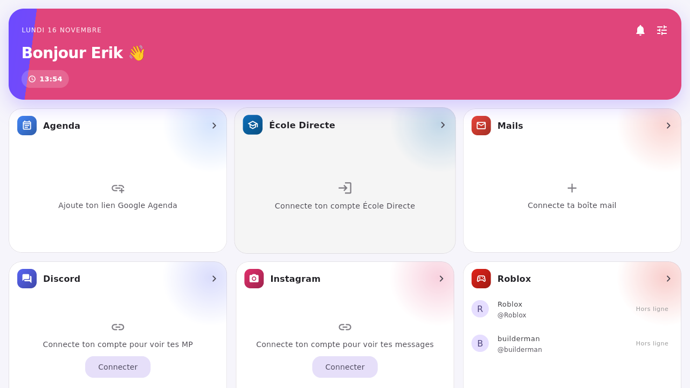
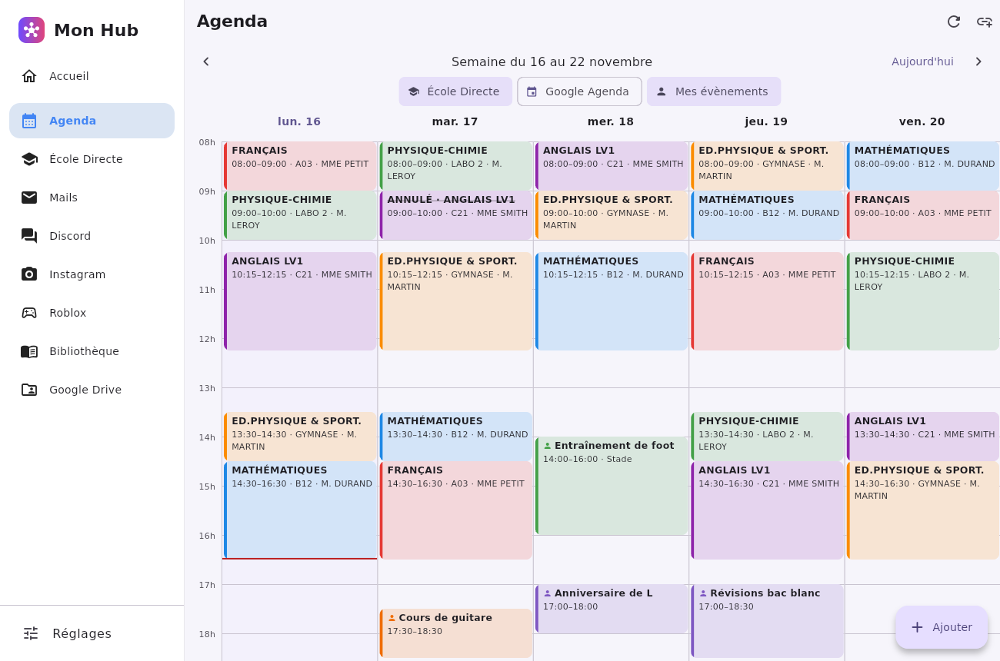

# Mon Hub

Une vraie application (pas un site) qui regroupe au même endroit : emploi du
temps, École Directe, mails, Discord, Instagram, comptes Roblox, livres lus et
raccourcis Google Drive. Chaque bloc est un **module** qu'on peut masquer,
réordonner, retirer ou remplacer.








> 📥 **Installer : voir [INSTALL.md](INSTALL.md)** · [Télécharger la dernière version](https://github.com/Shideyx/mon-hub/releases/latest)

## Sur quels appareils ?

Écrite en **Flutter** : un seul code pour **Windows, Android, iPhone/iPad,
Mac et Linux**. Chaque appareil reçoit une vraie appli native installée.

| Appareil | Comment l'obtenir |
|---|---|
| Windows | Dossier `MonHub-Windows` produit par GitHub Actions → lancer `hub.exe` |
| Android | `app-release.apk` produit par GitHub Actions → l'installer sur le téléphone |
| Mac / Linux | Idem, artefacts `MonHub-macOS` / `MonHub-Linux` |
| iPhone | `MonHub-iOS.ipa` (non signé) à installer avec Sideloadly depuis un PC, voir INSTALL.md |

## Ce que chaque module sait faire (honnêtement)

| Module | Accès | Ce qui marche |
|---|---|---|
| **Agenda** | ✅ Officiel (iCal) + École Directe + local | Un seul emploi du temps, présenté comme celui d'École Directe (grille horaire, couleurs par matière, cours annulés barrés) : **cours École Directe** + **Google Agenda** (adresse secrète iCal, lecture seule) + **tes propres évènements** (ajouter, modifier, supprimer, répéter chaque semaine). Filtre par source, rappel 15 min avant. |
| **École Directe** | ⚠️ Non officiel | Emploi du temps, devoirs (avec contenu), notes, messagerie (lecture). Alertes : nouvelle note, nouveau devoir, nouveau message, cours annulé. Pas d'API publique : peut casser après une mise à jour d'École Directe. |
| **Mails** | ✅ Standard (IMAP/SMTP) | Lire les mails en entier, répondre, écrire, plusieurs boîtes. Gmail : **mot de passe d'application** (l'appli ouvre la bonne page). Outlook/Hotmail : pas encore (Microsoft impose OAuth). |
| **Discord** | ⚠️ Jeton utilisateur | Lire et **écrire** tes MP, démarrer une conversation avec un ami, alerte à chaque nouveau message. Connexion intégrée (la vraie page discord.com). Discord interdit officiellement l'automatisation d'un compte : risque de suspension faible mais réel. Serveurs : widget public officiel. |
| **Instagram** | ⚠️ API privée | Lire et **répondre** à tes conversations, alerte à chaque nouveau message, via l'API interne d'instagram.com (comme les projets de github.com/topics/instagram-api). Connexion intégrée. Si l'API web refuse, l'appli bascule toute seule sur l'API mobile d'Instagram. |
| **Roblox** | ⚠️ Semi-public | Plusieurs comptes : avatar, nombre d'amis, statut (en ligne / en jeu). Utilise les API publiques du site Roblox, sans mot de passe. |
| **Bibliothèque** | ✅ Local | Étagère visuelle avec couvertures, statut *Lu / En cours / À lire*, étoiles, note « À retenir », statistiques, recherche Open Library. |
| **Google Drive** | Raccourcis | Liens vers tes documents Drive (emploi du temps PDF, etc.). |

## Comptes, thème et Claude

* **Comptes Mon Hub** : page de connexion (identifiant + mot de passe) au démarrage. Chaque compte a ses modules, réglages et connexions, rangés à part (mot de passe stocké sous forme d'empreinte salée). Les comptes sont propres à l'appareil : *Exporter / Importer* pour passer d'un appareil à l'autre.
* **Mode clair / sombre / auto** : bouton 🌙 sur l'accueil et *Réglages → Apparence*.
* **Claude** : module qui intègre claude.ai (ton compte habituel). Sur PC, l'extension `claude-extension/` (fichier `MonHub-Claude.mcpb`) permet à l'appli Claude de lire et d'agir dans Mon Hub via un pont local (`lib/core/claude_bridge.dart`, 127.0.0.1 + clé secrète). Chaque module déclare ses actions dans `tools`.

## Notifications

Mon Hub vérifie tes comptes toutes les 2 minutes (réglable) et affiche une alerte système : nouveau mail, nouveau MP Discord ou Instagram, nouvelle note et cours annulé sur École Directe, rappel 15 min avant un évènement de l'agenda. Chaque module peut être mis en sourdine dans les réglages. Les alertes arrivent tant que l'appli tourne (même réduite).

## Configurer une seule fois pour tous tes appareils

Réglages → *Exporter ma configuration* sur le PC, puis *Importer une configuration* sur le téléphone. Le fichier contient tes identifiants : ne le partage pas.

L'appli publiée sur GitHub ne contient **aucun identifiant** : chacun y connecte ses propres comptes.

Mots de passe et jetons sont stockés dans le coffre sécurisé du système
(Gestionnaire d'identification Windows, Keystore Android, Trousseau Apple).

## Ajouter, retirer ou remplacer un module

Dans l'appli : bouton ⊞ en haut à droite → cocher/décocher, glisser pour
réordonner.

Dans le code, tout passe par **un seul fichier** :
[`lib/core/module_registry.dart`](lib/core/module_registry.dart).

1. Créer `lib/modules/mon_module/mon_module.dart` avec une classe qui étend
   `HubModule` (voir [`lib/core/hub_module.dart`](lib/core/hub_module.dart)) :
   `id`, `name`, `icon`, `color`, `buildSummary()` (la tuile) et
   `buildPage()` (la page complète). `store` donne un stockage privé au module.
2. L'ajouter à la liste dans `module_registry.dart`.

Pour un simple module de raccourcis (TikTok, YouTube, Pronote…), pas besoin
de code : ajouter une ligne `LinksModule(...)` dans cette même liste.

## Développer

```bash
flutter pub get
flutter run -d windows   # ou: android, macos, linux, chrome…
flutter test
```

Structure :

```
lib/
  main.dart                 démarrage
  core/                     contrat de module, stockage, registre, contrôleur
  ui/                       tableau de bord, page Modules, widgets communs
  modules/<nom>/            un dossier par module, indépendant des autres
```
