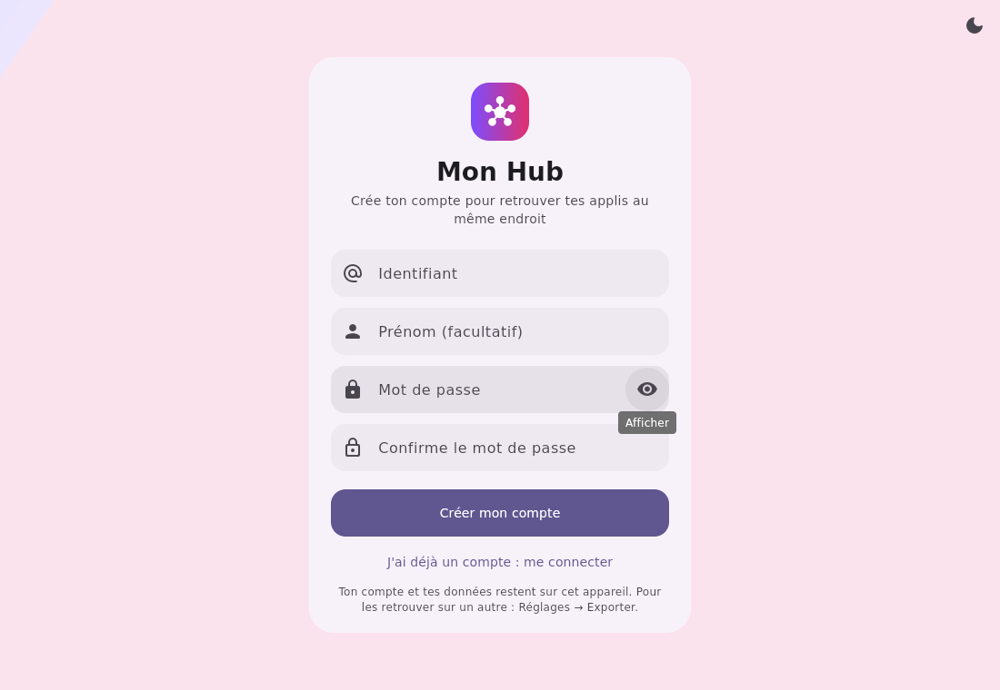
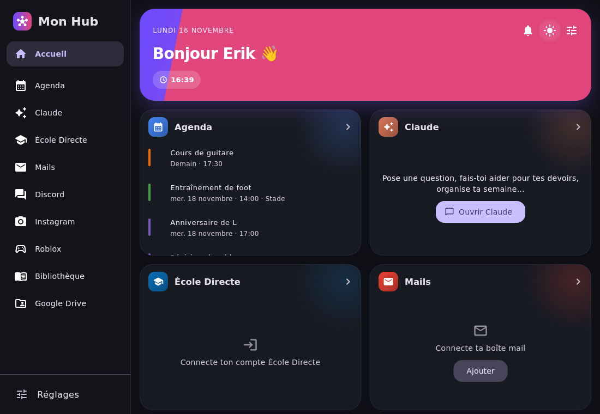
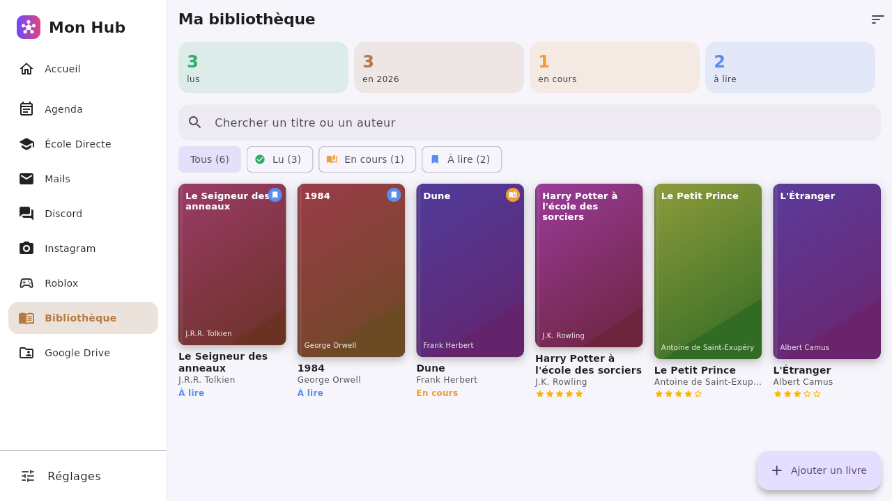

# Mon Hub

Une vraie application (pas un site) qui regroupe au même endroit : emploi du
temps, École Directe, mails, Discord, Instagram, comptes Roblox, livres lus et
raccourcis Google Drive. Chaque bloc est un **module** qu'on peut masquer,
réordonner, retirer ou remplacer.









> 📥 **Installer : voir [INSTALL.md](INSTALL.md)** · [Télécharger la dernière version](https://github.com/Shideyx/mon-hub/releases/latest)

## Sur quels appareils ?

Écrite en **Flutter** : un seul code pour **Windows, Android, iPhone/iPad,
Mac et Linux**. Chaque appareil reçoit une vraie appli native installée.

| Appareil | Comment l'obtenir |
|---|---|
| Windows | Dossier `MonHub-Windows` produit par GitHub Actions → lancer `hub.exe` |
| Android | `app-release.apk` produit par GitHub Actions → l'installer sur le téléphone |
| Mac / Linux | Idem, artefacts `MonHub-macOS` / `MonHub-Linux` |
| iPhone | `MonHub-iOS.ipa` (non signé) à installer avec Sideloadly depuis un PC, voir INSTALL.md |

## Ce que chaque module sait faire (honnêtement)

| Module | Accès | Ce qui marche |
|---|---|---|
| **Agenda** | ✅ Officiel (iCal) + École Directe + local | Un seul emploi du temps, présenté comme celui d'École Directe (grille horaire, couleurs par matière, cours annulés barrés) : **cours École Directe** + **Google Agenda** (adresse secrète iCal, lecture seule) + **tes propres évènements** (ajouter, modifier, supprimer, répéter chaque semaine). Filtre par source, rappel 15 min avant. |
| **École Directe** | ⚠️ Non officiel | Emploi du temps, devoirs (avec contenu), notes, **messagerie** : reçus et envoyés, lecture (texte propre : accents, listes, mise en forme Word nettoyée), **pièces jointes** à télécharger, réponse. Comptes parents : la messagerie de la famille (`/familles/…`, comme le site officiel). **Cloud** École Directe en entier : tous tes dossiers ouverts d'un coup, les clouds des espaces de travail et les documents de l'établissement (bulletins, vie scolaire, administratifs), recherche dans tout, ouvrir ou enregistrer les fichiers (Clicky aussi : outils `ecole_cloud`). Alertes : nouvelle note, nouveau devoir, nouveau message, cours annulé. Pas d'API publique : peut casser après une mise à jour d'École Directe. |
| **Mails** | ✅ Standard (IMAP/SMTP) | Lire les mails en entier, répondre, écrire, plusieurs boîtes. Gmail : **mot de passe d'application** (l'appli ouvre la bonne page). Outlook/Hotmail : pas encore (Microsoft impose OAuth). |
| **Discord** | ⚠️ Jeton utilisateur | Lire et **écrire** tes MP, **écouter les messages vocaux** (lecteur avec onde, vitesse ×1,5 / ×2), voir les **réactions** et qui les a mises, double-clic = ❤️, démarrer une conversation avec un ami, alerte à chaque nouveau message. Connexion intégrée (la vraie page discord.com). Discord interdit officiellement l'automatisation d'un compte : risque de suspension faible mais réel. **Tous tes serveurs** (icônes, salons par catégorie, lire et écrire dans les salons, rejoindre un salon vocal). **Appels sans navigateur** : le Discord officiel reste ouvert en fond, caché derrière Mon Hub ; quand on t'appelle, Mon Hub sonne (Répondre / Refuser / en vidéo) et l'appel se passe dans Mon Hub (désactivable dans l'onglet Messages privés). |
| **Instagram** | ⚠️ API privée | Lire et **répondre** à tes conversations, **écouter les vocaux**, voir les **❤️ / réactions** sur les messages (et qui les a mises, double-clic = ❤️), **qui a aimé** chaque publication du fil, onglet **Activité** (tes publications avec leurs j'aime, « X a aimé ta photo »…), alerte à chaque nouveau message, via l'API interne d'instagram.com (comme les projets de github.com/topics/instagram-api). Connexion intégrée. Si l'API web refuse, l'appli bascule toute seule sur l'API mobile d'Instagram. |
| **Carnet** | ✅ Local | Les plugins de ton ancien JARVIS, dans Mon Hub et à la voix avec Clicky : **mémoire** (« retiens que… », Clicky s'en sert ensuite), **idées en vrac** (« note ça », Clicky trie après), **tâches et notes**, **budget** (« j'ai dépensé 12 € au resto », bilan du mois par catégorie), **sport** (charges, records), **jeux** (sessions, statut), **poèmes** (avec l'avis de Clicky), **météo + conseil de tenue** (Open-Meteo, sans clé), **bilan du soir**, **protocoles** (« Clicky, protocole travail » : applis, sites, playlist Spotify, pause, notification…), **historique du presse-papier** (désactivé par défaut, ignore les mots de passe), **notification sur ton téléphone** (ntfy). |
| **Musique** | ✅ Officiel (Spotify) + Deezer public | **En écoute** : ce que joue l'appli Spotify, Deezer ou ton navigateur (lu dans Windows, sans connexion), avec une **boîte de CD qui tourne sur elle-même** et le **CD (pochette imprimée dessus) qui en sort et tourne**, toute la page aux couleurs de l'album, : la pochette devant, la tracklist de l'album au dos (titre en cours en gras), le titre écouté en très grand, l'artiste, la tracklist, le compteur, les couleurs prises sur la pochette ; lecture / pause / suivant / précédent, ❤️. **Choisir** : recherche dans tout Spotify (titres, artistes, albums, playlists), touche pour lancer, ⋮ pour ajouter à la file, choix de l'appareil (PC, téléphone, enceinte) et du volume, file d'attente (lecture depuis Mon Hub : Spotify Premium ; sinon le morceau s'ouvre dans l'appli Spotify). **Titres likés**, **playlists**, **écoutes récentes** (Spotify, avec ton propre Client ID gratuit de developer.spotify.com ; ou favoris et playlists publics Deezer, extraits de 30 s), lecteur web Spotify / Deezer intégré. |
| **Roblox** | ⚠️ Semi-public | **Tableau de bord de ton jeu** : joueurs en ligne en direct, visites, favoris, j'aime, serveurs (remplissage, ping), badges (rareté), game passes, courbes d'évolution (joueurs, visites par jour, favoris) construites par les relevés de Mon Hub, alertes de paliers (1 000 visites…), liens Creator Hub. Plus tes comptes : avatar, amis, statut. API publiques du site Roblox, sans mot de passe (les Robux gagnés restent sur le Creator Hub). |
| **Bibliothèque** | ✅ Local | Étagère visuelle avec couvertures, statut *Lu / En cours / À lire*, étoiles, note « À retenir », statistiques, **retrouve tout seul le livre** à partir du titre (Open Library + Google Livres, meilleur résultat proposé, couverture au format livre 2:3, couvertures manquantes complétées toutes seules, choix parmi les couvertures trouvées). |
| **Google Drive** | ✅ Officiel (Google) | Ton Drive en visuel : dossiers, fichiers avec miniatures, Récents / Partagés / Suivis, recherche, espace utilisé, ouverture dans l'appli. Via « Se connecter avec Google » (lecture seule). Sans connexion Google : drive.google.com intégré. |

## Interface façon Windows 11

Police Segoe UI Variable, fond gris clair / gris foncé comme Paramètres de Windows 11, cartes bordées d'un trait fin, menu de gauche avec la barre d'accent, **couleur d'accent de ton Windows**, barre de titre assortie (claire / sombre). Les liens s'ouvrent dans **Google Chrome** (Réglages → Apparence pour changer).

**Widgets sur le bureau** : attrape un widget de l'accueil par son titre et lâche-le hors de Mon Hub (ou bouton « Détacher ») : il devient une petite fenêtre à part, avec **sa propre icône dans la barre des tâches**, qu'on peut garder devant les autres fenêtres. Mon Hub se souvient de sa place et le rouvre au démarrage ; « Remettre dans Mon Hub » le ramène dans l'accueil (`hub.exe --widget=<module>`, `widget_window.dart`). Glisser une carte sur une autre les échange.

**YouTube** : tout le vrai YouTube dans Mon Hub (ton compte, abonnements, playlists), recherche et « Reprendre » sur l'accueil (historique gardé sur l'appareil) ; Clicky peut chercher, lancer et mettre en pause une vidéo (`youtube_chercher`, `youtube_lire`, `youtube_controle`).

**Photos et appels** : dans une conversation Instagram ou Discord, 🖼 envoie une ou plusieurs photos (converties en JPEG pour Instagram) ; 📞 / 📹 lance un appel vocal ou vidéo **dans Mon Hub** (le vrai site, micro et caméra autorisés, bouton d'appel appuyé tout seul). Clicky aussi : outils `instagram_envoyer_photo`, `discord_envoyer_fichier`, `instagram_appeler`, `discord_appeler`.

## Notifications

Les alertes (messages, notes, devoirs, compagnons, Clicky) arrivent dans la cloche de l'accueil **et** en bandeau dans la fenêtre de Mon Hub (en haut à droite), en plus de la notification de Windows.

## Dépannage

Réglages → *Journal des erreurs* : ce qui a planté (gardé sur le PC seulement), à copier pour corriger un souci. Clicky partout est relancé tout seul s'il se ferme.

## Connexions sécurisées

Au démarrage, Mon Hub fait confiance aux certificats de Windows (dont ceux d'un antivirus ou du réseau) et à la liste officielle de Mozilla (`assets/cacert.pem`, `lib/core/certificates.dart`) : plus d'erreur « CERTIFICATE_VERIFY_FAILED » (Spotify, École Directe…).

## Confidentialité et sécurité

* **Aucun serveur** : Mon Hub ne parle qu'aux services que tu utilises (École Directe, Spotify, Google…), directement depuis ton appareil. Le créateur de l'appli n'a accès à aucune donnée de personne.
* **Mots de passe et jetons** : dans le coffre du système (Gestionnaire d'identification Windows, Trousseau, Keystore Android).
* **Données locales chiffrées** : historiques de Clicky, journal, carnet, routines sont chiffrés en AES-256-GCM, avec une clé par compte rangée dans le coffre du système (`lib/core/vault.dart`).
* **Compte sur plusieurs appareils** (si tu l'actives) : une copie de ton compte est gardée dans **ton** Google Drive, dans le dossier « Mon Hub - compte synchronisé », chiffrée avec ton mot de passe Mon Hub (PBKDF2 + AES-256-GCM) : ni Google ni le créateur de l'appli ne peuvent la lire (`lib/core/account_sync.dart`).
* **Export protégé** par un mot de passe (PBKDF2 + AES-256-GCM) : le fichier est illisible sans lui.
* **Connexion Mon Hub** : après 5 mots de passe faux, attente de plus en plus longue (jusqu'à 15 min).

## Comptes, thème et Claude

* **Comptes Mon Hub** : page de connexion (identifiant + mot de passe) au démarrage. Chaque compte a ses modules, réglages et connexions, rangés à part (mot de passe stocké sous forme d'empreinte salée). **Le même compte sur tous tes appareils, sans export** : *Réglages → Mes appareils → Activer la synchronisation*, puis sur l'autre PC, page de connexion → *Retrouver mon compte d'un autre appareil* (même compte Google, même mot de passe). Ensuite les changements passent d'un appareil à l'autre tout seuls, toutes les 3 minutes.
* **Mode clair / sombre / auto** : bouton 🌙 sur l'accueil et *Réglages → Apparence*.
* **Clicky** : un compagnon IA, ton assistant personnel façon JARVIS d'Iron Man, qui vit à côté de ton curseur (comme heyclicky.com et [clicky-windows](https://github.com/Bitshank-2338/clicky-windows)), avec ton **abonnement Claude Pro** comme cerveau (Mon Hub lance ton Claude Code officiel : `claude -p` en stream-json, aucun outil de programmation, les actions de Mon Hub via le serveur MCP local `/mcp`, permission avant toute modification — voir `lib/ui/clicky/claude_code.dart` ; une clé API ou Ollama restent possibles). Maintiens **Ctrl + Alt** et parle (appui court = écrire), ou dis **« Clicky »**. Tout se règle dans module Claude → Réglages.
  * **Look « réacteur »** (par défaut, ou le curseur classique) : un réacteur cyan animé à côté du curseur (anneaux qui tournent quand il réfléchit, onde autour quand il écoute, viseur quand il montre), fenêtres « tête haute », voix posée qui t'appelle par ton prénom, salutation le matin, **briefing** (cours, devoirs, notes, messages), petit bip d'activation (`lib/ui/clicky/hud.dart`).
  * **Vivant** : il flotte et bouge tout seul autour de ta souris, fait de petites boucles, s'allume au démarrage (« CLICKY EN LIGNE »), et sa boîte (comme la fenêtre de Clicky partout) **s'attrape par la barre du haut pour la poser où tu veux**. Bandeau tête haute : heure, météo, agents au travail.
  * **Hologrammes 3D** : molécules, atomes, planètes, solides, ADN… projetés en fil de fer lumineux qui tourne (glisser pour pivoter), quand ça aide à comprendre (`[HOLO]{json}[/HOLO]`, `holo.dart`).
  * **Visite guidée** animée à la création du compte (et revoyable dans les réglages) : chaque capacité présentée en animation (`tutorial.dart`).
  * **Voir, parler, montrer** : il voit tous tes écrans, répond à voix haute **dès la première phrase** pendant que la réponse s'écrit, son curseur vole en arc jusqu'au bouton (`[POINT:x,y:libellé:screenN]`), et il **dessine sur l'écran** : flèches, cercles, soulignés, étiquettes (`[ARROW]`, `[CIRCLE]`, `[UNDERLINE]`, `[LABEL]`, `marks.dart`). **Pointage précis** en option : zoom + grille 6 × 6, deuxième passe (`pointer.dart`).
  * **Prof** : leçons **pas à pas** (« dis suivant »), tableau visuel et quiz (`board.dart`), commandes vocales « suivant », « répète », « stop », « nouvelle conversation », « interroge-moi », « qu'est-ce qu'on a vu aujourd'hui / cette semaine ? », « qu'est-ce que je dois réviser ? », « change de voix pour Paul » (`tutor.dart`) ; modes **lent**, **quiz**, **code** (éditeur détecté), **multilingue**, **lecture du petit texte** (OCR intégré à Windows, `ocr.dart`).
  * **Journal des connaissances** + **répétition espacée** (1 → 3 → 7 → 14 → 30 → 60 → 120 jours) : chaque notion est notée, révisions en quiz, onglet Journal (`journal.dart`).
  * **Historique** : toutes les conversations avec Clicky sont gardées (une **mémoire par appli** avec Clicky partout), à revoir, rechercher, renommer, épingler et **reprendre** (bouton ⟲ dans la boîte, onglet « Historique Clicky »). Même chose pour la discussion avec Claude (onglet Discuter, liste des conversations sur le côté), et **tes conversations claude.ai** s'y ajoutent avec le bouton « Synchroniser l'historique » de l'onglet claude.ai (accès non officiel, depuis ta session ouverte). Fichiers du compte dans `%APPDATA%\MonHub\data\…`, partagés entre Mon Hub et Clicky partout (`lib/ui/chat_history.dart`, `lib/core/hub_files.dart`).
  * **Documents** : joins un PDF (lu en entier par Claude), un Word, un Excel (valeurs et formules), un PowerPoint, du texte, du code ou une photo, puis pose tes questions dessus (`documents.dart`).
  * **Internet** : recherche web officielle de Claude pour l'actualité, la météo… (désactivable).
  * **Mains libres** : mot d'activation « Clicky » (reconnaissance de Windows en liste fermée, sur le PC, `wake.dart`) ; **dictée partout** : Ctrl + Alt + Maj, le texte est tapé dans l'appli ouverte (ou copié si la fenêtre a changé).
  * **Contrôle du PC** : « Clicky, installe VLC », « range mes téléchargements », « mets le son à 30 % », « combien de place sur mon disque ? »… : il le fait lui-même (commandes PowerShell, fichiers, applis, réglages, `pc.dart`). Par défaut chaque commande s'affiche et attend ton « Autoriser » ; mode « Sans demander » dans les réglages (les commandes dangereuses sont toujours demandées).
  * **Réponse instantanée** (comme le JARVIS « Mark LII ») : avec ta clé Gemini gratuite, ta voix part en direct vers **Gemini Live**, qui répond tout de suite en voix (morceau par morceau, connexion gardée ouverte et préparée au démarrage). Il garde les actions de Mon Hub, peut regarder l'écran, prendre la souris, et passe la main à Claude pour un tableau ou un schéma (`live.dart`, `pcm_player.dart`). Réglages Clicky → Voix.
  * **Clicky agit** (Clicky partout) : « prends la main et… », ou demande-lui de faire quelque chose : il regarde l'écran, vole jusqu'à l'endroit, et la vraie souris suit (clic, double-clic, défiler, glisser-déposer, écrire, raccourcis, ouvrir une appli ou un site, passer d'une fenêtre à l'autre), puis regarde de nouveau, jusqu'à 30 actions. Échap ou bouger la souris l'arrête ; jamais de saisie dans une fenêtre sensible (`act.dart`).
  * **Compagnons** (vidéo « agent buddies ») : quatre questions pour te connaître, puis de petits agents (nom, couleur, petit nuage aux yeux ^^) se proposent d'eux-mêmes ; Non / Ajuster / Oui, fais-le ; ils travaillent en arrière-plan, certains chaque jour, et te préviennent (`buddies.dart`, onglet Compagnons).
  * **Secrétaire** : il organise ton emploi du temps (créneaux libres entre les cours, planning de révisions enregistré d'un coup avec ta permission) et te conseille.
  * **Tableau dessiné en direct** : écriture manuscrite sur papier quadrillé, chaque bloc se trace l'un après l'autre.
  * **Clicky pilote** (Clicky partout) : « fais-le pour moi » → un plan de clics / frappe / raccourcis à **relire avant**, Échap ou bouger la souris arrête tout, rien dans les fenêtres sensibles, aucune commande système (`drive.dart`).
  * **Routines** : tâches automatiques (briefing du matin, devoirs du soir, bilan de la semaine…) avec tes modules, résultat lu à voix haute et gardé (onglet Routines, `routines.dart`). Mode **« Agent, … »** pour une tâche de fond ponctuelle.
  * **Capture des gestes** (« qu'est-ce que je viens de faire ? », sans jamais garder les lettres tapées) et **enregistrement de leçon** (compte rendu + captures dans Documents\Mon Hub\Leçons) : menu ⋮ de la boîte (`capture.dart`).
  * **Raccourcis vocaux** à toi (une phrase → ouvrir un site, lancer un programme, dire une phrase, poser une question) et **outils MCP** en plus (serveurs HTTPS ajoutés par toi, chaque action avec permission, `extensions.dart`).
  * **Vie privée** : pas de capture quand un gestionnaire de mots de passe ou une banque est ouvert à l'écran ; Échap arrête la réponse et la voix à tout moment.
  * **Micro sur Windows** : **Whisper** (whisper.cpp, sur le PC, sans internet, installé en un clic : Réglages → Écoute) ou la reconnaissance vocale moderne de Windows en français ; en mode Automatique, Whisper prend le relais dès que Windows ne marche pas (comme Win + H, `ears.dart`), Réglages → **Tester le micro**. **Clicky se répare tout seul** : si la reconnaissance vocale ne démarre pas, il la relance d'une autre façon (sans fichier, avec fichier, lancement classique) ; sinon bouton **« Clicky répare »**, ou dis / écris « répare le micro » : il essaie tout, et s'il reste bloqué il t'explique le réglage à changer (outils `clicky_diagnostic` et `clicky_reparer_micro`, utilisables aussi par l'IA). **Voix** : voix neurales Microsoft (Rémy multilingue par défaut) ou Gemini, vitesse et hauteur réglables (la voix de Windows a été retirée). Sur Windows, **Clicky partout** : une fenêtre transparente suit la souris au-dessus de toutes les applis (`hub.exe --clicky`, `clicky_desktop.dart`).
* **Logo et raccourcis** : icône Mon Hub sur toutes les plateformes ; raccourcis Bureau + menu Démarrer créés et réparés automatiquement sur Windows (entrée du menu des applications sur Linux).
* **Claude** : discussion directe (ton abonnement Claude Pro, ou une clé API) **avec l'historique de toutes tes conversations**, + claude.ai intégré (ton compte habituel). Sur PC, l'extension `claude-extension/` (fichier `MonHub-Claude.mcpb`) permet à l'appli Claude de lire et d'agir dans Mon Hub via un pont local (`lib/core/claude_bridge.dart`, 127.0.0.1 + clé secrète). Chaque module déclare ses actions dans `tools`.

## Topo du matin et du soir

Chaque matin (à 7 h, ou dès que tu allumes le PC jusqu'à midi), Clicky fait ton **topo du matin**, comme JARVIS : météo et quoi mettre, les infos importantes en France et dans le monde (franceinfo, Le Monde, France 24), tes **mails importants** (sans les pubs), et **École Directe** (cours du jour, cours annulés, devoirs et contrôles, nouvelles notes, messages non lus), puis tes tâches. Le soir (20 h 30), le **topo du soir** : bilan de ta journée, devoirs et emploi du temps de demain, météo de demain, actus du jour. Il s'affiche en grand chez Clicky, il est lu avec sa voix, rangé dans l'historique, et envoyé sur ton téléphone si ntfy est configuré. **Désactivables** (et heure réglable) : module Claude → Réglages → *Topo du matin et du soir*. Dis aussi « briefing » à n'importe quel moment.

## Voix de Clicky (gratuite)

* **Voix neurale Microsoft** (par défaut) : les voix de la lecture à voix haute d'Edge (Henri, Denise, Rémy…), très naturelles, **gratuites et sans clé** (accès non officiel, comme l'outil libre edge-tts). Sans internet, Clicky répond par écrit.
* **Gemini** : la voix de Google, avec une **clé gratuite** d'AI Studio (quota gratuit limité par jour ; quand il est épuisé, la voix Microsoft prend le relais).

## Mises à jour automatiques (Windows)

Mon Hub vérifie au démarrage puis toutes les 30 minutes s'il existe une version plus récente sur GitHub (page « Releases »). Si oui, l'appli **se met en pause** et un **écran de téléchargement** s'affiche : progression, nouveautés (le message de la mise à jour), vérification de l'empreinte du fichier, puis installation par-dessus et redémarrage tout seul. Tes comptes et réglages ne bougent pas (ils sont dans `%APPDATA%`). « Plus tard » reporte au prochain démarrage ; Réglages → *Vérifier les mises à jour* relance la recherche. Voir `lib/core/updater.dart`.

Pour distribuer l'appli sous ton propre dépôt, rien à changer : la compilation GitHub y inscrit le dépôt qui l'a compilée (`--dart-define=UPDATE_REPO=compte/depot`), et chaque copie se met à jour depuis ses propres releases.

## Notifications

Mon Hub vérifie tes comptes toutes les 2 minutes (réglable) et affiche une alerte système : nouveau mail, nouveau MP Discord ou Instagram, nouvelle note et cours annulé sur École Directe, rappel 15 min avant un évènement de l'agenda. Chaque module peut être mis en sourdine dans les réglages. Les alertes arrivent tant que l'appli tourne (même réduite).

## Configurer une seule fois pour tous tes appareils

Sur le premier appareil : *Réglages → Mes appareils → Activer la synchronisation* (choisis ton compte Google). Sur les autres : page de connexion → *Retrouver mon compte d'un autre appareil* → le même compte Google → ton mot de passe Mon Hub. Modules, réglages, connexions, historiques, carnet et révisions arrivent tout seuls, puis restent synchronisés (le plus récent gagne, réglage par réglage). Ce qui est propre à un PC (widgets posés sur le bureau, raccourcis) reste sur ce PC.

**Pas accès au premier PC ?** Sur le nouveau : *Retrouver mon compte d'un autre appareil* → ton compte Google → *Demander mon compte à mon PC principal*. Si Mon Hub est ouvert sur le PC principal (avec ce compte Google connecté), il voit la demande et envoie le compte tout seul, chiffré, en quelques minutes. PC principal éteint ? Recrée ton compte avec le même identifiant et le même mot de passe, puis *Réglages → Mes appareils → Récupérer les données de mon PC principal* : ses données arrivent et se fusionnent dès qu'il est rallumé.

Sans internet : *Réglages → Mes appareils → Sans internet : passer par un fichier* (exporter / importer). Le fichier contient tes identifiants : ne le partage pas.

L'appli publiée sur GitHub ne contient **aucun identifiant** : chacun y connecte ses propres comptes.

Mots de passe et jetons sont stockés dans le coffre sécurisé du système
(Gestionnaire d'identification Windows, Keystore Android, Trousseau Apple).

## Ajouter, retirer ou remplacer un module

Dans l'appli : bouton ⊞ en haut à droite → cocher/décocher, glisser pour
réordonner.

Dans le code, tout passe par **un seul fichier** :
[`lib/core/module_registry.dart`](lib/core/module_registry.dart).

1. Créer `lib/modules/mon_module/mon_module.dart` avec une classe qui étend
   `HubModule` (voir [`lib/core/hub_module.dart`](lib/core/hub_module.dart)) :
   `id`, `name`, `icon`, `color`, `buildSummary()` (la tuile) et
   `buildPage()` (la page complète). `store` donne un stockage privé au module.
2. L'ajouter à la liste dans `module_registry.dart`.

Pour un simple module de raccourcis (TikTok, YouTube, Pronote…), pas besoin
de code : ajouter une ligne `LinksModule(...)` dans cette même liste.

## Développer

```bash
flutter pub get
flutter run -d windows   # ou: android, macos, linux, chrome…
flutter test
```

Structure :

```
lib/
  main.dart                 démarrage
  core/                     contrat de module, stockage, registre, contrôleur
  ui/                       tableau de bord, page Modules, widgets communs
  modules/<nom>/            un dossier par module, indépendant des autres
```
